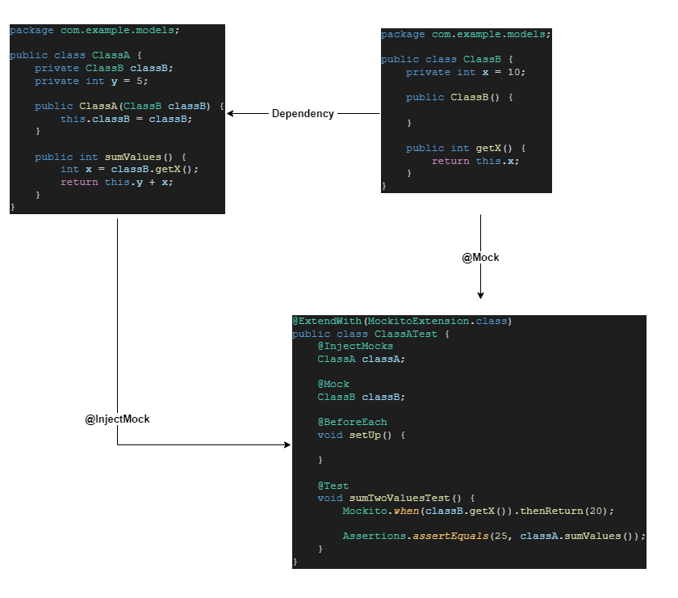

# JUnit and mockito - Overview and Examples <!-- omit in toc -->

## Contents <!-- omit in toc -->

- [1. What is a Unit Test](#1-what-is-a-unit-test)
- [2. Why write Unit Tests?](#2-why-write-unit-tests)
- [3. F.I.R.S.T. Principle](#3-first-principle)
- [4. Test Code in Isolation](#4-test-code-in-isolation)
- [5. JUnit dependencies](#5-junit-dependencies)
- [6. Mockito](#6-mockito)
  - [6.1. Test Double](#61-test-double)
  - [6.2. Types of Test Doubles](#62-types-of-test-doubles)
  - [6.3. Mockito dependencies](#63-mockito-dependencies)
  - [6.4. Annotations](#64-annotations)
  - [6.5. asd](#65-asd)

# 1. What is a Unit Test

- A Unit test is very small method that you write to test some part of your code.

# 2. Why write Unit Tests?

- Make sure that the code works,
- Code works with valid and invalid input parameters,
- Code works now and in the future,
- Other code still works even after you made changes.

# 3. F.I.R.S.T. Principle

- **Fast** - Unit tests run fast.
- **Independent** - Unit tests are independent.
- **Repeatable** - Unit tests are repeatable.
- **Self-validating** - Unit test validates itself.
- **Thorough & Timely** - Cover edge case.

# 4. Test Code in Isolation

# 5. JUnit dependencies

- Option with less dependencies:

  ```xml
      <dependency>
          <groupId>org.junit.jupiter</groupId>
          <artifactId>junit-jupiter-api</artifactId>
          <version>5.11.0</version>
          <scope>test</scope>
      </dependency>
      
      <dependency>
          <groupId>org.junit.jupiter</groupId>
          <artifactId>junit-jupiter-engine</artifactId>
          <version>5.11.0</version>
          <scope>test</scope>
      </dependency>

      <!-- To @ParameterizedTest -->
      <dependency>
          <groupId>org.junit.jupiter</groupId>
          <artifactId>junit-jupiter-params</artifactId>
          <version>5.11.0</version>
          <scope>test</scope>
      </dependency>
  ```

- Full option:

```xml
    <dependency>
        <groupId>org.junit.jupiter</groupId>
        <artifactId>junit-jupiter</artifactId>
        <version>5.11.0</version>
        <scope>test</scope>
    </dependency>
```

# 6. Mockito

- **What is Mockito?**
  - Mockito is an open source testing framework created for Java.
  - It allows us to easily create "test doubles" objects in unit tests.

## 6.1. Test Double

- **What is Test Double?**
  - Test doubles are stand-ins for the real components of your software under test.
- They mimic the behavior of these components, allowing you to test the code in isolation without relying on any dependencies.
- Different testing types require varying functioning features of the software.
- There might be cases where a certain test run may need the function to return a numeric value.
  

## 6.2. Types of Test Doubles

- Choosing the right test double for such test scenarios is critical.
- This is the list of different types of test doubles available:
  | Types | Description |
  | ------- | ------------------------------------------------ |
  | Fake | Simplified implementation<br>Basic functionality |
  | Stub | Predetermined responses<br>Mimics behavior |
  | Mock | Behavior verification<br>Method call tracking |
  | Dummies | Placeholder objects<br>No functionality |
  | Spies | Interaction monitoring<br>Observes behavior |

## 6.3. Mockito dependencies

```xml
    <dependency>
        <groupId>org.mockito</groupId>
        <artifactId>mockito-junit-jupiter</artifactId>
        <version>5.14.2</version>
        <scope>test</scope>
    </dependency>
```

## 6.4. Annotations

- `@ExtendWith(MockitoExtension.class)` - To the test class and annotating mocked fields with `@Mock`.
  - `@RunWith(MockitoJUnitRunner.class)` - JUnit 4
- `@InjectMocks` - Creates an instance of the class and injects the mocks that are created with the `@Mock` (or `@Spy`) annotations into this instance.
- `@Mock` - Creates a mock implementation for the classes we need.
- **Example**

  ```java
    @ExtendWith(MockitoExtension.class)
    public class ExampleClassTest {
        @InjectMocks
        MyServiceToBeTested myServiceToBeTested;

        @Mock
        MyDependency myDependency;
    }
  ```

  

## 6.5. asd
